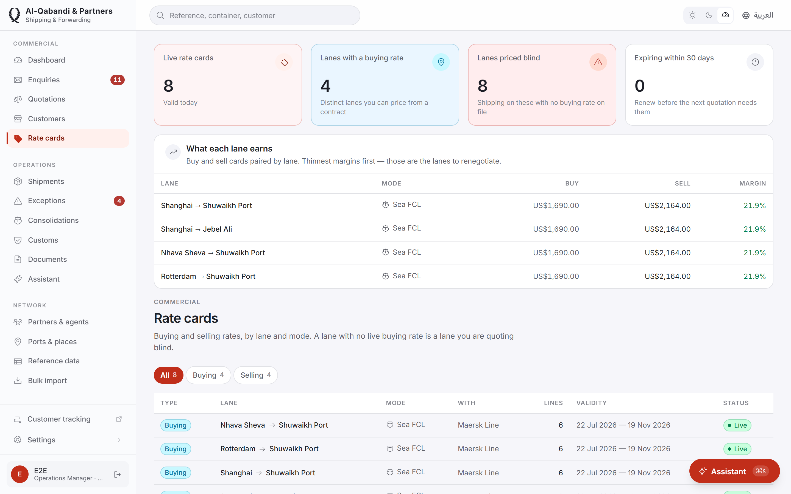

# Operations Manager

**You hold everything a coordinator holds, plus the reversals, the rate cards
and the reference data. This chapter covers the difference.**

> Read [**Getting started**](00-orientation.md) and then
> the [**Coordinator**](01-coordinator.md) chapter — everything in the coordinator's
> chapter is yours too, and it is not repeated here.

---

## What is yours alone

| | Why it sits with you and not below you |
|---|---|
| **Cancel, complete and close shipments** | A coordinator moves work forward. Reversing it is an escalation, and it should cost a conversation. |
| **Close enquiries won or lost** | Win rate is a number that gets managed if the people measured on it can set it. |
| **Accept and reject quotations** | The commercial decision, not the administrative one. |
| **Write rate cards** | The pricing of every future quotation comes from here. |
| **Add agents, hauliers and carriers** | Your partner network is a register, not a free-text field. |
| **Add ports, places and reference data** | Deliberately operational, not administrative — see below. |
| **Read reports** | The dashboards, **Finance → Reports**, and every export. |

And three things you share with Finance, because each is a decision somebody
has to own and the person who answers for the relationship is as often you as
the accountant:

| | What it is |
|---|---|
| **Split a consolidation's master cost** | Decides what every house under the master cost, and therefore every margin. A coordinator builds the master; splitting it is yours — see below. |
| **Let a customer trade past their credit limit** | Booking checks credit. A credit override is recorded on the customer, with a reason, and it is yours or Finance's — see below. |
| **Run a set-off with an agent** | Netting what an agent owes you against what you owe them. **Finance → Settlements**; the mechanics are in the [**Finance**](04-finance.md#settlements) chapter. |

**You cannot touch invoices.** Approving, issuing, voiding or crediting an
invoice is Finance's alone, and an operations manager who could issue invoices
is the segregation-of-duties failure an auditor asks about first. This is not an
oversight and it is not configurable in the shipped role matrix. The same line
runs through payables: you can capture a supplier's bill and match it against
the job, and you cannot approve it for payment.

---

## Reading the dashboard properly

The dashboard is built to be read in one pass, top to bottom, and the order is
the argument.

**The line at the top** tells you how many things need you today. When it says
nothing does, believe it.

### The four numbers that mean something is wrong now

| | What it is actually telling you |
|---|---|
| **SLA breached** | Enquiries you promised to answer and have not. Not a backlog — a broken promise, and it is countable. |
| **Due today** | The ones about to join them. This is where a morning is well spent. |
| **Demurrage accruing** | Containers past their free days. This number is money leaving, per day, right now. |
| **Exceptions** | Everything wrong on live shipments, oldest first. |

**Oldest first is the whole point.** The newest exception has somebody looking at
it. The one at the top of that list has been open longest, which usually means it
belongs to nobody. Work down from the top, not up from the bottom.

### The four numbers that tell you how the business is running

| | How to read it |
|---|---|
| **Win rate** | Quotes won against quotes sent this month. Falling win rate with stable volume is a pricing problem; falling volume with stable win rate is a demand problem. They need different responses. |
| **Average margin** | What you keep on a typical quotation before overheads. Watch it against win rate — a rising win rate and a falling margin means somebody is buying work. |
| **Median response** | Enquiry to quotation. The number your customers actually experience. Averages hide the bad days; this is the median for that reason. |
| **Enquiries received** | Fourteen days, with the previous week for comparison. |

### The rest

**Shipments by stage and by mode** — what is moving and how. **Busiest lanes** —
by shipment count, which is where rate-card attention pays for itself. **Where
the cargo is** — every live shipment drawn as a line; thicker means more of them.

**Arriving this week** is the one to check on a Sunday morning. Everything on it
needs documents ready and clearance arranged before it lands, and the cost of
finding out late is demurrage.

---

## Rate cards

**Network → Rate cards.** This screen is the most valuable one you own, and the
subtitle states the case: *a lane with no live buying rate is a lane you are
quoting blind.*

### The four numbers at the top

| | What to do about it |
|---|---|
| **Live rate cards** | Valid today. |
| **Lanes with a buying rate** | Distinct lanes you can price from a contract rather than from memory. |
| **Lanes priced blind** | **Start here.** You are shipping on these with no buying rate on file. Each one is a margin you are guessing. |
| **Expiring within 30 days** | Renew before the next quotation needs them, not after a customer notices. |

### Buy and sell

Cards come in two directions. A **buy** card is what an agent or carrier charges
you and belongs to that partner. A **sell** card is what you publish, either to
everyone or to a named customer.

**What each lane earns** pairs them by lane and shows the thinnest margins first.
Those are the lanes to renegotiate — and it is a better list than the one you
would write from memory, because it is ordered by fact.

### Validity, and the thing it prevents

Every card has validity dates, and the system makes **two overlapping cards on
the same lane impossible** — not discouraged, impossible. If an import or an
entry is rejected for overlapping an existing card, that is the protection
working. Correct the dates on one of the two; do not work around it by creating
the card under a slightly different lane.

This is the rule that stops two people quoting the same lane at two different
prices in the same week.

### Loading a card

Small changes by hand. A carrier contract arriving as a spreadsheet goes through
**Network → Bulk import** — see the [**Administrator**](06-administrator.md#bulk-import) chapter.
It checks every line before writing anything, and if a single line fails, nothing
is written.

---

## Reference data — and why it is yours

**Network → Reference data**, plus **Network → Ports & places** for the
locations. The screen lists the tables the rating, milestone and clearance
engines read — and warns at the top about any that are empty, because an empty
one fails silently three screens away as "no rate found":

| Table | What it drives |
|---|---|
| **Charge types** | What can appear as a line on a quotation or an invoice, and the revenue and cost account each posts to |
| **Commodities**, **Container types**, **Incoterms**, **Document types**, **Exception codes** | The pickers everywhere else |
| **Milestone plans** | The steps a job of each shape — mode and direction — is booked with |
| **Working calendars** | Weekend, hours and closures, per branch — what every SLA, ageing and free-time clock counts against |
| **Tariff** | Duty rates by HS prefix, for the duty estimate. Longest matching prefix wins; with none loaded, estimates fall back to the GCC common rate of 5%. |
| **Volumetric rules** | The divisor each mode's chargeable weight is billed on, and what it rounds to |
| **Free-time terms** | The days granted before demurrage starts, and the rate after — what a new clock is filled in from |

**This sits with operations rather than administration on purpose.** A shipment
routed through a depot nobody has recorded cannot be booked until somebody
records it. If that waits for an administrator, what actually happens is that
somebody types the depot into a notes field — and the system grows a free-text
"other" that swallows the data it was built to structure.

So you can add a port on the morning a new lane opens. The corresponding
responsibility: **add it properly, once.** Two entries for the same port is worse
than none, because every report silently splits between them.

### Milestone templates

The stages applied to a shipment when it is booked, per mode and direction.

**Name them the way your operations people say them out loud**, not the way a
textbook does. If your team says "gate in", the milestone should say "gate in".
People do not tick a checklist written in somebody else's vocabulary, and a
milestone that is not ticked is a tracking page that lies to your customer.

### Working calendars

Sunday to Thursday, plus your public holidays, per branch. Every SLA clock and
every ageing rule counts against this. **Load next year's holidays before
January**, or every deadline over the break will be wrong in the same direction.

---

## Partners and agents

Agents, hauliers, carriers — with their people, the lanes they cover, their
papers, and their account with you. Each partner's page carries:

| | |
|---|---|
| **People there** | Who to call. Kept on the partner, not in somebody's phone. |
| **Where they go** | The lanes this partner covers, by mode, with transit days. A partner with no lanes is never suggested for a quote. |
| **Papers** | Licences and certificates, with the date each lapses. |
| **Current account** | Link the partner to the customer record they invoice you as, and both directions of the relationship net into one balance. Needed before a set-off can be run. |
| **Bill tolerance** | How far this partner's bills may drift from what a job accrued before Finance is asked to look — a percentage, an absolute amount, or both; whichever is more generous applies. Leave both at zero and the charge type's own tolerance is used. |

**Keep the expiry dates real.** An agent whose trade licence expired four months
ago is a compliance problem that surfaces during an audit rather than during the
job, and the register is only worth having if the dates in it are true.

---

## Consolidations — splitting the master cost

A coordinator opens the master and attaches the houses; the mechanics are in
the [**Coordinator**](01-coordinator.md#consolidations) chapter. What is yours is
**Split**: dividing each master-level cost across the houses under it, by
volume, chargeable weight, gross weight, packages, equally, or stated by hand.

A split writes an ordinary charge line onto every house, so job profitability,
invoicing and the accounting export need to know nothing about consolidation.
**Reverse** posts the negative rather than deleting, because the lines may
already sit on an issued invoice.

**Per-house margin is a fiction until the master cost is split.** A
consolidation closed with its costs unsplit is twenty jobs whose margin is
overstated by exactly the freight.

---

## Credit overrides

Booking a shipment checks the customer's credit standing for the branch:
outstanding against limit, and whether they are on hold. A booking that would
take them past the limit is refused, and the message says so.

The answer, when there is one, is **Record an override** on the customer's page
— under *Standing and exceptions*, which shows the exposure, the limit, the
headroom and every exception ever made. An override covers one shipment or one
invoice, or everything for that customer until a date you give. The limit stays
where it is; what is recorded is the exception, who made it, and why.

**The reason is the record.** Write a sentence somebody reviewing this in a year
can act on. Not "approved".

---

## Notification wording

**Settings → Notification wording** is the one settings screen you hold, on the
same permission as reference data, because it is the same kind of thing: what
the product says when it writes to a customer or a colleague, editable without a
release.

Each event — a shipment is booked, a milestone is reached, the ETA moves, a
document is released, an invoice is issued or goes overdue, a quotation is sent
or about to expire, an enquiry arrives or misses its SLA, an exception is
raised, free time is running out, a rate card is about to lapse — has a subject
and a message in both languages. **Reword** it for every entity, or for one
branch alone, which overrides the default beneath it. The available merge fields
are listed on the dialog; anything else sends as blank.

**What actually sends** is separate from the wording. Turning an event off there
stops it being sent; the master switch, **Send notification email**, silences
the whole channel, and every notification is still recorded, marked *Held back*.
The **Delivery** log underneath shows every notification and what became of it,
failures first.

---

## The reversals

### Cancelling a shipment

**Move it on** to *Cancelled* — available from draft, booked, in transit, on
hold. It does not delete anything — the shipment stays, marked cancelled, with
everything that happened to it intact.

**The reason is required, and it stays on the record.** In six months the
question will be why, and the record is the only place that will still know.

### Completing and closing

**Complete** means operationally finished — delivered, nothing outstanding.
**Close** means financially finished, and it is the last step. Closing a job
whose costs have not all landed is how a lane's margin ends up looking better
than it was; the accrued free-time charges in particular arrive after delivery.

Check the job's costs before you close it, not after.

### Releasing a hold

A held shipment returns to whichever stage it was in. Record why it was released
in the exception that presumably caused it — a hold with no exception behind it
is a decision nobody can reconstruct.

---

## What to look at, and when

| When | What | Why |
|---|---|---|
| **Every morning** | Dashboard, top to bottom | Breached SLAs and the oldest exception |
| **Every morning** | Arriving this week | Documents and clearance, before it lands |
| **Twice a week** | Exceptions, oldest first | The top of that list is what nobody owns |
| **Weekly** | Demurrage accruing | Money leaving per day |
| **Weekly** | Rate cards — expiring within 30 days | Renew before a quotation needs it |
| **Monthly** | What each lane earns, thinnest first | The renegotiation list |
| **Monthly** | Win rate and average margin together | One without the other misleads |
| **Quarterly** | Lanes priced blind | Contracts to go and get |
| **Before January** | Working calendars | Next year's holidays |

---

## Things worth refusing

**A coordinator asking you to fix a price on a quotation.** Fix the rate card.
Fixing the quotation fixes one job and hides a fault that will produce ten more.

**A request for a free-text field.** Every one of them is a report that cannot be
run. If the data has categories, it belongs in reference data where it can be
counted.

**Closing a job to tidy the board.** The board is meant to show what is
outstanding. A tidy board with open costs behind it is a management report that
is wrong.

**Backfilled milestone dates.** A week of dates entered on Thursday is a shipment
that looks perfect and tells you nothing — and a customer who watched the
tracking page say nothing for four days.
