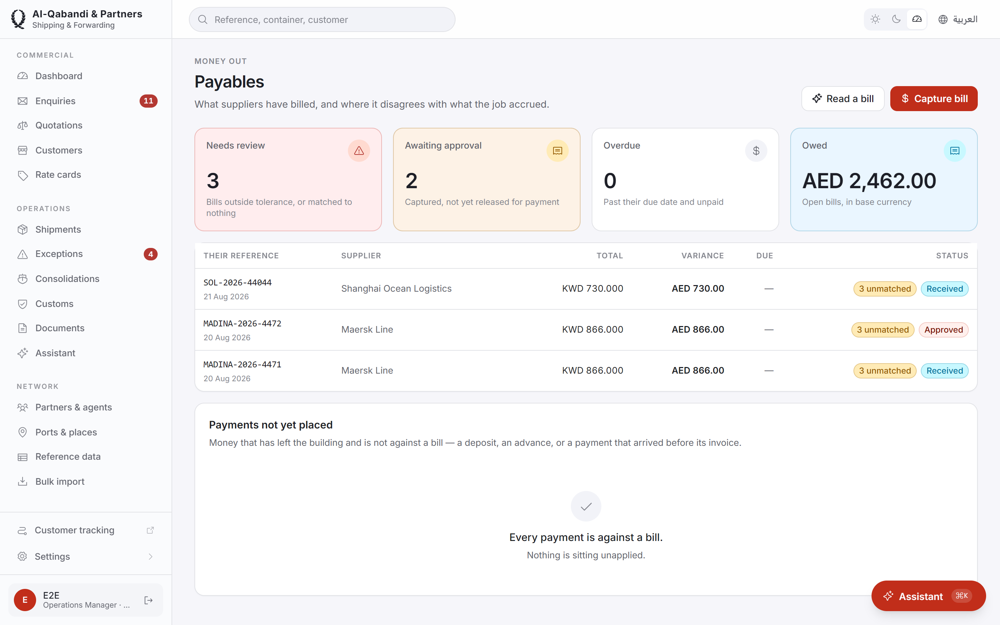

# Finance

**Invoicing, receipts and receivables. Yours alone, and deliberately so.**

> Read [**Getting started**](00-orientation.md) first.

---

## What you hold, and why nobody else does

| Yours alone | Also yours |
|---|---|
| Approve an invoice | Record duty paid on a customs declaration |
| **Issue** an invoice | Capture a supplier's bill and match it |
| Void an invoice | Run a set-off with an agent |
| Raise a credit note | Split a consolidation's master cost across its houses |
| Record a receipt | Let a customer trade past their credit limit |
| **Approve** a supplier's bill for payment, and **pay** it | Read every shipment |
| Post the period to the accounting package | Read and export the dashboards and the margin report |

**Only Finance may issue, void or credit.** An operations manager who could
issue invoices is the classic separation-of-duties failure, and it is the first
one an auditor asks about. It is enforced by the system, not by an instruction —
which is the answer you can give when asked. The same line runs through money
out: a coordinator or an operations manager can capture what an agent billed,
and only you can approve it for payment or pay it.

You **cannot** book or update shipments, change rate cards, or send quotations.
If an invoice is wrong because the job is wrong, the job gets fixed by operations
and the invoice gets credited by you. Neither of you fixes the other's record.

---

## The receivables screen

**Finance → Overview.** The subtitle is the whole job: *what you are owed, how
late it is, and who to ring about it.*

| | What it means |
|---|---|
| **Owed to you** | Across every open invoice |
| **Overdue** | Past the due date |
| **Received** | What has come in |
| **Unallocated receipts** | **Money in the bank not yet matched to an invoice** |

### Unallocated receipts are the one to clear first

The screen warns about them explicitly, and the reason is worth stating: *until
a receipt is matched, the customer still shows as owing money they have already
paid.*

Every consequence of that is bad. You chase a customer who has paid. Their credit
limit blocks a booking they are entitled to. Your ageing report overstates the
debt and your management makes decisions on it.

**Clear them daily.** It is ten minutes and it is the highest-value ten minutes
in this chapter.

### Ageing

Everything unpaid, grouped by how late it is: not due yet, 1–30, 31–60, 61–90,
over 90. The screen offers a piece of judgement with it — *anything beyond 60
days is usually a phone call, not a reminder* — and it is right.

### Who owes the most

Largest balance first, not oldest. **Chase the biggest exposure before the oldest
debt.** A four-month-old invoice for a small amount is an irritation; a
six-week-old invoice for a large one is a risk.

Use the ageing view to decide *how* to chase and this view to decide *whom*.

### Earned, not yet billed

Above the ageing, a panel counts the shipments carrying revenue that has never
reached an invoice — how many lines, how much, and how old the oldest is. An
unbilled charge line never ages, never appears in the ageing and is never
chased, which is why it gets its own space.

**Draft invoice** against a row raises a draft for that shipment with its
unbilled revenue lines on it, ready to approve and issue. A shipment whose
lines are in more than one currency is flagged *Mixed currencies — bill
separately*.

---

## Invoicing

### The states, and what each one commits

| State | What it means | Reversible? |
|---|---|---|
| **Draft** | Being built. No number yet. Charges can be added and changed. | Yes |
| **Approved** | Reviewed and ready. Still no number, still editable. | Yes — back to draft |
| **Issued** | **It takes the next number in the branch's series.** | **No** |
| **Part paid** / **Paid** | Receipts matched against it | — |
| **Void** | Cancelled. The number stays used. | No |
| **Credited** | A credit note replaces it | No |

**Issuing cannot be undone.** The system says so before you do it. An issued
invoice can only be corrected by a credit note — and that is the point, because
an invoice that can be silently edited after the customer has it is not a
document either of you can rely on.

**Voiding keeps the number.** The series has no gap. An invoice series with a
missing number is a question at every audit, and the answer *"we deleted it"* is
never a good one.

### Building it

Add charges while it is a draft. Each line carries:

- **Description** — what the customer will actually read
- **Charge type** — groups the line on the printed invoice
- **Quantity, unit price**
- **Taxable** — tax is added at this invoice's rate where the line is taxable

Totals recalculate from the lines. There is no total you type over.

### Tax treatment

Set per invoice: **standard rate**, **zero rated**, **exempt**, **out of scope**,
**reverse charge**.

This is not decoration — it is what makes an invoice raised by your UAE entity
and one raised by your Kuwait entity both correct at the same time. Set it from
the entity and the transaction, not from habit.

### Document language

Each invoice carries its own language, English or Arabic. Set it to what the
customer wants to receive, not to what you are reading the screen in.

### Currency

Every charge line stores **its own exchange rate and the moment it was taken**.
A job quoted in dollars and invoiced in dinars reconciles months later because
the rate is recorded rather than recalculated.

**Amounts round per currency at the line.** KWD carries three decimal places and
the system knows it. You do not need to correct dinar amounts for rounding, and
you should not try.

---

## Receipts

**Finance → Payments.** What came in, and how much of each has been matched.

Record: the date received, the customer, their reference, the method — bank
transfer, cheque, cash, card or offset — and the amount.

**Then allocate it.** A receipt can be matched across several invoices, and part
of a receipt can sit unallocated if the customer has overpaid or paid on account.
The register shows what is matched and what is not, and the overview screen
counts the unmatched ones at the top.

**Recorded by** is captured automatically. So is the time. Neither can be
changed afterwards.

---

## Duty

You can record duty paid on a customs declaration. So can the customs broker and
the operations manager; a coordinator cannot.

The declaration shows the duty assessed. Recording payment moves the declaration
forward toward release, and it is usually what somebody is waiting on — a
container sitting for a payment nobody recorded is demurrage accruing on your own
delay.

---

## Charges that appear without anyone entering them

**Free-time clocks write their own charge lines.** Demurrage, detention and
storage accrue against the carrier's free days and post automatically, against
the right counterparty at the right per-diem rate.

Two consequences for you:

1. **Do not enter these by hand.** You will duplicate them.
2. **They arrive after delivery.** A job closed the day it was delivered may
   close before its last accrued charge lands. This is why the operations manager
   is told to check job costs before closing, and it is worth being the person
   who reminds them.

---

## Payables

**Finance → Payables.** What suppliers have billed, and where it disagrees with
what the job accrued. The subtitle is the job, and the four counters at the top
are the order to work in:

| | What it means |
|---|---|
| **Needs review** | Bills outside tolerance, or matched to nothing. **Start here.** |
| **Awaiting approval** | Captured, not yet released for payment |
| **Overdue** | Past their due date and unpaid |
| **Owed** | Open bills, in base currency |

### Capture, match, approve, pay — and who does which

Four acts, and the split is the separation of duties a forwarder actually runs
on:

| Act | Who | Why |
|---|---|---|
| **Capture bill** | Coordinator, operations manager, or you | The coordinator holding the file is the only person who can say which of the thirty shipments on a monthly agent invoice each line belongs to |
| **Match** each line to the job's cost line | The same | Billing more than was accrued is allowed — that is the finding |
| **Approve** for payment | **You alone** | With the variance in front of you. Approving a bill that is 15% over its accrual is a decision somebody has to own |
| **Record payment**, then **Allocate** it | **You alone** | Moving the money |

Collapsing the first two with the third would mean the person who entered the
bill is the person who cleared it — the segregation failure an auditor asks
about immediately after invoice issuance.

**Read a bill** captures from a scan: upload the PDF or a photograph and the
lines are read for you. It lands as *Received*, like anything typed in, and you
still approve it. If the figures do not add up, nothing is written and the scan
is kept on file. It needs a model key under *Settings → Integrations*.

### Lines and matches

Open a bill. Each of their lines sits beside what it was matched to, with a
verdict: **Agrees**, **Within tolerance**, **Billed over**, **Billed under**,
**Not billed**. Tolerance comes from the charge type, or from the partner's own
tolerance where one has been set on their page — whichever is more generous.

**Approve** is offered when everything agrees. When something does not, the
bill says so — *Some lines are outside tolerance, or matched to nothing at all*
— and approving means ticking **Approve anyway** and writing why the variance is
acceptable. That reason is the record. **Dispute** sends it back with what is
wrong; **Void** is only for a bill nothing has been paid against. Their invoice
number is captured exactly as printed, and capturing the same number twice is
refused.

### Payments not yet placed

At the foot of the payables screen: money that has left the building and is not
against a bill — a deposit, an advance, a payment that arrived before its
invoice. **Allocate** each one. Part payments are the norm.

---

## Settlements

**Finance → Settlements.** An agent is both a supplier and a customer — they
bill you for the far end and you bill them for yours. A settlement nets both
sides of the account for a period into a single figure, so one payment moves
instead of two.

**Before anything can be netted, the partner must be linked to the customer
record they invoice you as** — *Current account* on their partner page. Nothing
guesses at which customer record an agent is, because a wrong guess nets a
settlement against a different company.

**Draft settlement** — branch, agent, period, and the agreed rate where the two
sides are in different currencies. One currency by agreement; a set-off is not a
currency trade. The draft lists every open document in the period that no
earlier settlement has claimed: your invoices and credit notes, their bills,
receipts and payments either way. It shows **They owe us**, **We owe them**, the
**Set off**, and the **Residual** with its direction — *They pay us*, *We pay
them*, or *Square*.

**Agree statement** when both sides have signed it off. **Residual settled**
when the balancing payment has moved. A settlement is never deleted; one that
was voided stays on the list with the reason against it.

Running a set-off is yours and the operations manager's. It changes what both
sides owe without any money moving, so it sits with whoever answers for the
relationship rather than with either ledger.

---

## Credit control

Each customer's page carries **Standing and exceptions**: what they owe, their
credit limit, the headroom or the excess, and every override ever made for
them. Amounts in a currency with no exchange rate are listed separately, and
the exposure shown is a floor rather than a total.

**Booking checks this.** A customer on hold, or one a shipment would take past
their limit, cannot be booked, and the coordinator is told so. The answer is
**Record an override** — for one shipment, one invoice, or everything for that
customer until a date — with a reason a reviewer can act on in a year. The
limit itself is set under the customer's commercial terms and stays where it
is.

You and the operations manager both hold this, and that is deliberate: a check
only one of you can clear is a check that gets routed around at four in the
afternoon.

**Unallocated receipts feed straight into this.** A customer who has paid and
whose receipt sits unmatched is a customer whose booking is refused for money
they do not owe.

---

## Consolidations

A coordinator builds the master and attaches the houses; **Split** divides each
master cost across them, by volume, chargeable weight, gross weight, packages,
equally, or stated by hand. It writes an ordinary charge line onto every house,
so invoicing and the export need to know nothing about consolidation, and
**Reverse** posts the negative rather than deleting, because the lines may
already sit on an issued invoice. Splitting is yours and the operations
manager's — it decides twenty margins at once.

---

## Export

**Accounting exports**, on the overview screen, hand a period to your
accounting package as a journal — invoices, credit notes, costs and receipts,
posted to the accounts mapped on each branch.

| | What it does |
|---|---|
| **Preview journal** | Builds the journal for an entity and a period, and marks nothing. Run it as often as you like. |
| **Post period** | Stamps every invoice, cost and receipt it covers. A second export of the same period finds nothing. |
| **Void** | Releases everything the export claimed, with a reason kept on the record, so the period can be exported again. |

**Post once you are satisfied with the preview.** Posting consumes the period;
getting it back is a void with a reason, and *"why was this period posted
twice"* is a question the reason has to answer.

**The accounts come from the branch.** *Settings → Branches* carries each
entity's chart of accounts — receivables, payables, bank, output tax, FX
variance, rounding — and each charge type carries its revenue and cost account
under *Reference data*. Leave them blank until you have the codes; the export
names what is missing rather than guessing.

**There is no direct connector to an accounting package in this release.** The
journal export is the path today.

**Finance → Reports** is the margin report — shipments by the date they sailed,
cut by branch, customer, trade lane, mode or salesperson — and **Export CSV**
takes it out whole.

---

## Your week

| When | What |
|---|---|
| **Daily** | Unallocated receipts. Clear every one. |
| **Daily** | New receipts recorded and matched |
| **Daily** | Payables — *Needs review*, then *Awaiting approval* |
| **Weekly** | Overdue — the 61–90 and 90+ buckets, by phone |
| **Weekly** | Who owes the most — largest exposure first |
| **Weekly** | Earned, not yet billed — draft the invoices |
| **Weekly** | Payments not yet placed — allocate every one |
| **On completion** | Invoice the jobs operations has completed |
| **Before closing a job** | Check the free-time charges have landed and the consolidation costs are split |
| **Monthly** | Settlements — draft the set-off for each agent with a current account |
| **Monthly** | Preview the journal, then post the period; reconcile the receipt account |
| **Monthly** | Check the invoice number series has no gaps — voids should keep theirs |

---

## Four things not to do

**Do not edit an issued invoice by any route.** There is no route, and looking
for one means the credit note is the answer.

**Do not delete a receipt to correct it.** Nothing is deleted here. Correct the
allocation.

**Do not leave money unallocated over a weekend.** Everything downstream of it is
wrong until you do, including how your colleagues treat that customer.

**Do not close the month with unmatched receipts on the register.** The ageing
report is wrong by exactly that amount, and somebody will act on it.
