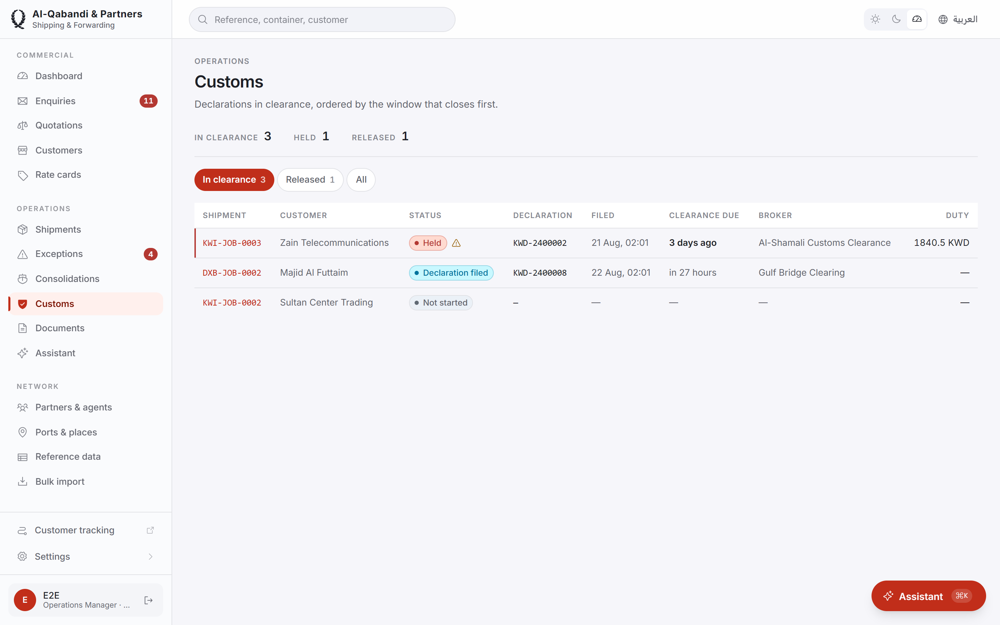

# Customs Broker

**A narrow role, on purpose. Declarations, and the shipment fields clearance depends on.**

> Read [**Getting started**](00-orientation.md) first.

---

## What you hold

| You can | You cannot |
|---|---|
| File and update a customs declaration | Create or book a shipment |
| Record duty paid | Cancel, complete or close one |
| Update shipments — dates, references, containers | Price an enquiry or send a quotation |
| Read every shipment in your branches | Add a rate card, agent or port |
| | Touch an invoice or a receipt |

The role is deliberately narrow. You need the declaration and the shipment fields
clearance depends on, and nothing else — which also means nothing else can go
wrong under your account.

---

## The customs screen

**Operations → Customs.** Declarations in clearance, **ordered by the window that
closes first**.

That ordering is the feature. It is not newest-first and it is not by shipment
reference: it is by which clearance deadline expires soonest, so the top of the
list is where the next problem is.

Each row shows the shipment, the customer, the declaration number, when it was
filed, when clearance is due, the broker, and the duty.

The counters at the top: **in clearance**, **held**, **released**, **inspection
required**. Held and inspection are the two that mean somebody must do something
today.

---

## The declaration, stage by stage

| Stage | What it means | What moves it on |
|---|---|---|
| **Not started** | Nothing filed | Documents arrive |
| **Waiting for documents** | The file is short something | The missing document |
| **Declaration filed** | Lodged with the authority | Assessment, or an inspection order |
| **Assessed** | Duty determined | Payment — recorded by you, Finance or the operations manager |
| **Duty paid** | Settled | Release, or an inspection |
| **Inspection** | Physical examination ordered | Release, or a hold |
| **Held** | Held by the authority | Re-inspection, or release |
| **Released** | Cleared to move | — |

**A declaration can be held from waiting-for-documents as well.** A file short of
a certificate long enough becomes a hold, and it looks exactly like a hold caused
by the authority. The way to prevent it is to record the missing document as an
exception on the shipment the day you notice it, not the day it becomes a hold.

**Record the declaration number as soon as you have it.** It is what everyone
else in the office uses to ask the authority anything, and it is what makes the
clearance auditable afterwards.

All of this is one dialog on the shipment — **Update customs**: the stage, the
broker, the declaration type and number, the duty payable as assessed, the
clear-by date the register sorts on, whether a physical inspection is required,
and notes. Only the stages customs can actually move to next are accepted.

### Before it is filed

**Estimate duty**, on the shipment, gives a landed cost before anything is
lodged: goods value, freight and insurance against the tariff loaded under
*Reference data → Tariff*, matched by the HS code on each cargo line, longest
prefix first. It is an estimate, not an assessment — the screen says so — and
both are kept, so the gap between them can be measured. Lines with no HS code
are left out unless you choose to apply the GCC general rate to them, which is
off by default because 5% on a code the tariff has no row for is a guess that
looks researched.

The **Customs declaration pack** is one of the documents the shipment can issue
from its bill parties and cargo lines — what you would otherwise retype into
the authority's system. Preview it in either language from **Issue and
preview**; issuing it is the coordinator's.

---

## Free time is running while you are working

Every day a container sits in clearance is a day against its free time.
Demurrage, detention and storage clocks run against the carrier's free days and
**write their own charge lines** when the free days run out.

Nobody has to notice, which cuts both ways: nobody has to notice, and nobody
does. The dashboard shows the total accruing across the branch, and the shipment
shows free days, chargeable days and the per-diem rate.

**The dates that stop clocks are yours to enter promptly.** Each clock under
*Free time* on the shipment has a start and an **Ends** date, and the end date
is what stops the accrual — charged days stay:

| The box | Stops | If you leave it late |
|---|---|---|
| **Gated out** of the terminal | Demurrage | The charge keeps accruing on paper after the box has left |
| **Empty returned** to the line | Detention | A detention clock that never stops — a wrong charge, and an argument with the customer you will lose |

Enter them on the day. Not at the end of the week.

---

## Exceptions

When clearance goes wrong — a hold, an inspection, a document that has not come,
a discrepancy in the declared value — **raise an exception on the shipment**.

Give it a severity, an owner and a due date, and the cost impact if there is one.
It appears on the operations board, oldest first, and it is how the rest of the
office finds out without you telling each of them separately.

**Raise it even when you expect to resolve it today.** How often a lane, an
agent or a commodity produces a hold is a pattern worth having, and it only
exists if the short-lived ones were recorded too.

---

## What this system does not do

**It does not file declarations.** You file where you file today — the
authority's own system, your broker portal, an agent. This system records the
declaration, its number, its status, the duty and the deadline, so that everyone
else can see where clearance has got to without ringing you.

For Kuwait specifically, direct filing is **not planned**. Access runs through a
long-standing concession that a supplier of this software has no route into, and
that is the honest position rather than a roadmap item.

**It does not assess duty.** It estimates it, from the tariff your operations
manager loads; what the authority determines on filing is what you record, and
the two are kept side by side.

**It does not receive authority status feeds.** Every customs status change is
entered by a person — you. Carrier milestone feeds are a different matter: your
administrator can switch on carrier-direct tracking for Maersk, Hapag-Lloyd and
CMA CGM under *Settings → Integrations*, with each carrier's own registration.
Until that is done, vessel milestones are typed too.

---

## Your day

| When | What |
|---|---|
| **First thing** | The customs screen. It is already ordered by which deadline closes first. |
| **First thing** | Held and inspection counters — these need action today |
| **On the day it happens** | Gated out, empty returned |
| **On the day you get it** | Declaration number, duty assessed, release |
| **As soon as you notice** | An exception for every hold, inspection or missing document |
| **Weekly** | Arriving this week, on the dashboard — clearance you can prepare before it lands |
