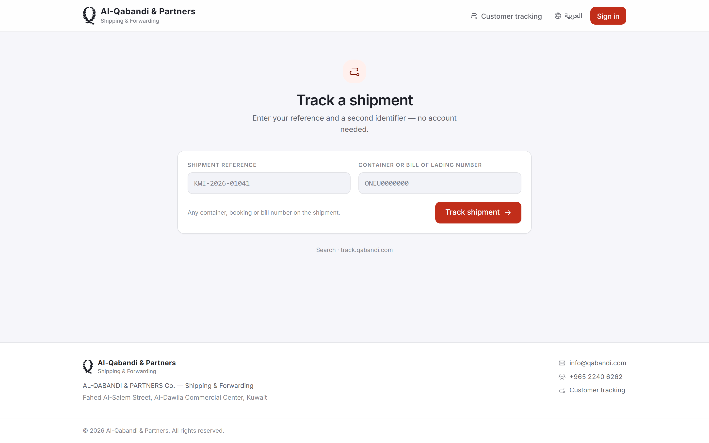

# Tracking your shipments

> **To the operator, before you send this:** this chapter is written to be handed
> to your customers under your own name. It contains no supplier branding and
> names no software. Replace `[Company]` with your company name, `[track URL]`
> with your tracking address, `[portal URL]` with your portal address, and
> `[phone]` / `[email]` with your operations contacts. Then delete this box.
>
> It has an Arabic counterpart. Send the one your customer reads.

---

There are two ways to see where your cargo is. Neither of them is ringing us,
though you are always welcome to.

| | For | Needs an account |
|---|---|---|
| **Track a shipment** | A quick check on one shipment | No |
| **The portal** | Everything we are moving for you, at a glance | Yes |

---

## Tracking one shipment — no account

Go to **[track URL]**.

You need two things, both of which are on your booking confirmation:

1. **The shipment reference** — for example `KWI-2026-01041`
2. **A container number, booking number or bill of lading number** from that
   shipment

Two identifiers rather than one, because a shipment reference on its own could be
guessed. Requiring something only you and we would know keeps your shipment
details yours.

### What you will see

| | |
|---|---|
| **Progress** | Each step of the journey, and how many are complete |
| **Route** | Where it is going from and to, and how it is travelling |
| **Vessel or flight** | What it is travelling on, and when it departed |
| **Estimated arrival** | And the actual arrival once it lands |
| **Notices** | Anything we have flagged on the shipment for you to know about |
| **Containers** | Numbers and types |
| **Documents** | Those we have released to you, listed by name and size. Ask us and we will send them over. |

Steps are marked **completed**, **in progress**, **scheduled** or **revised**.
*Revised* means a date has changed since the original plan — usually a vessel
schedule — and it stays visible rather than quietly replacing what we told you
before.

### Arabic and English

The language switch is at the top of the page. It changes everything, including
the direction the page reads.

### On your phone

The page is built for it. Bookmark it. Your reference is on your booking
confirmation and does not change for the life of the shipment.

### If nothing is found

Check both values against your booking confirmation — the second identifier must
belong to that same shipment. If it still does not work, ring us on **[phone]**
or email **[email]** and we will look.

---

## The portal — for your account

**[portal URL]**, with the sign-in we have set up for you. Ask us if you do not
have one.

### What is there

**My shipments.** Everything we are moving for you, with three counts at the
top — active shipments, arriving this week, documents released — and a card for
each shipment: the reference, where it stands, the route and how it is
travelling, your own reference if you gave us one, the estimated arrival, the
next step, and how far through its journey it is.

**For the full detail on one shipment** — each step with its dates, the
containers, the documents by name — use the tracking page with that shipment's
reference and a container or bill number. The portal is the overview; the
tracking page is the close-up.

**Documents.** Each shipment shows how many documents we have released to you,
and the tracking page lists them by name. Ask us and we will send them over.

### About documents

**You see what we have released, not everything that exists.** A document being
prepared, or one waiting on a correction, is not shown until it is final. This is
so that you never work from a draft.

If you expected a document and it is not there, ring us — it usually means it is
still in preparation, and we would rather tell you that than send you something
we are about to change.

**A released document that is later corrected keeps both versions.** You will see
the current one; the earlier one is not deleted, so if we ever need to agree what
was issued and when, the answer exists.

---

## Which one to use

**Tracking** is for the question *"where is it?"* — quick, no account, works on a
phone, and you can forward the link to your own customer with the two
identifiers.

**The portal** is for *"what is happening across everything of ours?"*

---

## Questions we get asked

**Can I see shipments that are finished?**
The portal lists your shipments in order of arrival, completed ones included,
up to fifty at a time; the count at the top is the active ones. Ask us for
anything beyond that and we will send it.

**Can more than one person in my company have access?**
Yes. Tell us who, and we will set them up.

**Why do I need two identifiers to track?**
So that nobody who happens to guess a reference number can see your shipment
details. It is your protection, not our bureaucracy.

**The estimated arrival changed.**
Vessel and flight schedules move. When ours changes, the page shows it as
*revised* rather than pretending the original date never existed. If a change
affects you, we will normally have rung you before you see it.

**Something looks wrong.**
Ring **[phone]** or email **[email]** with the shipment reference. The reference
is what makes it findable in seconds.

---

**[Company]** · **[phone]** · **[email]**
