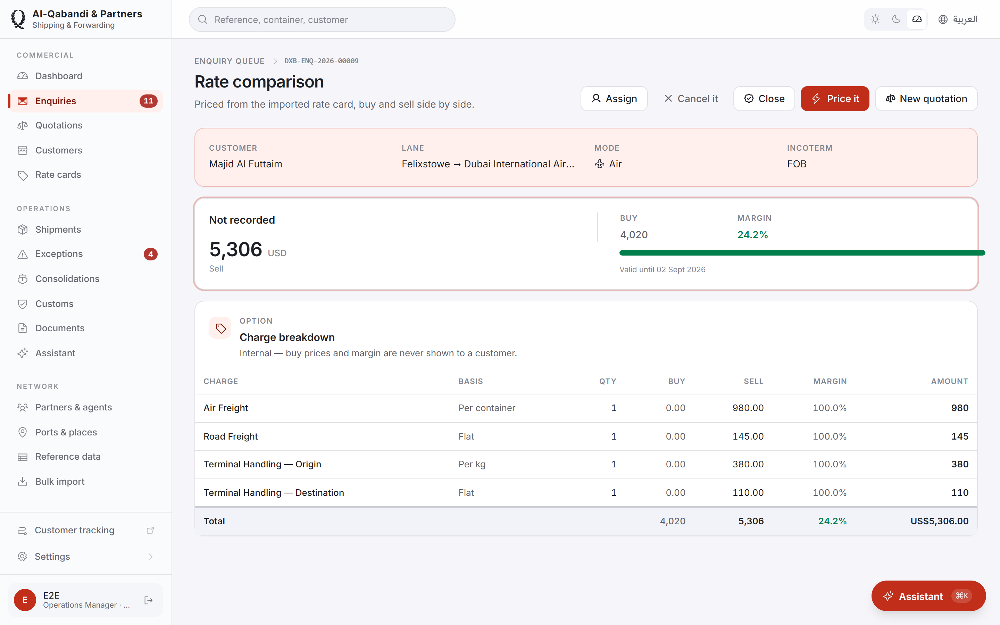
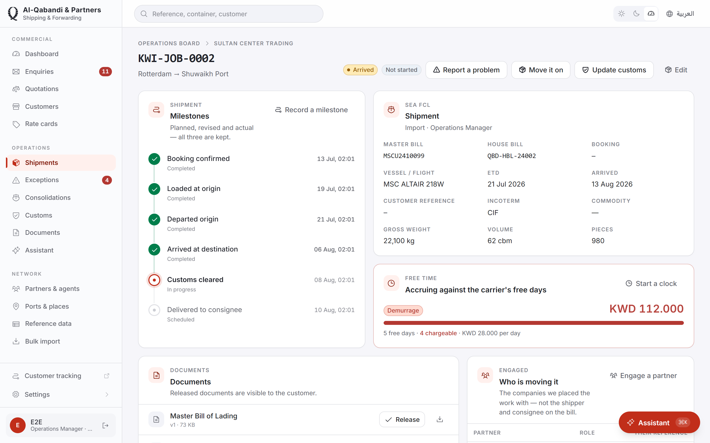
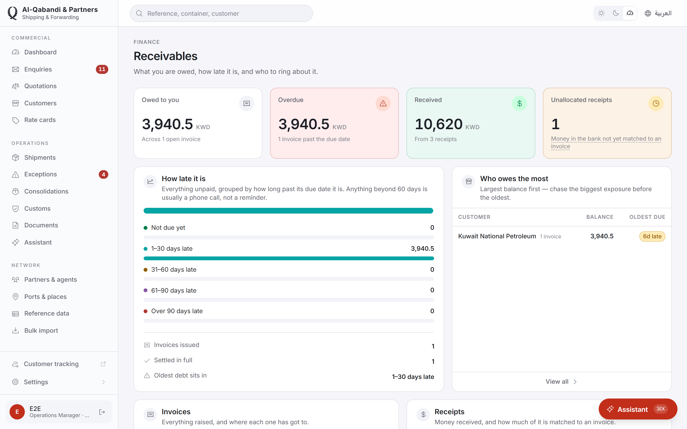
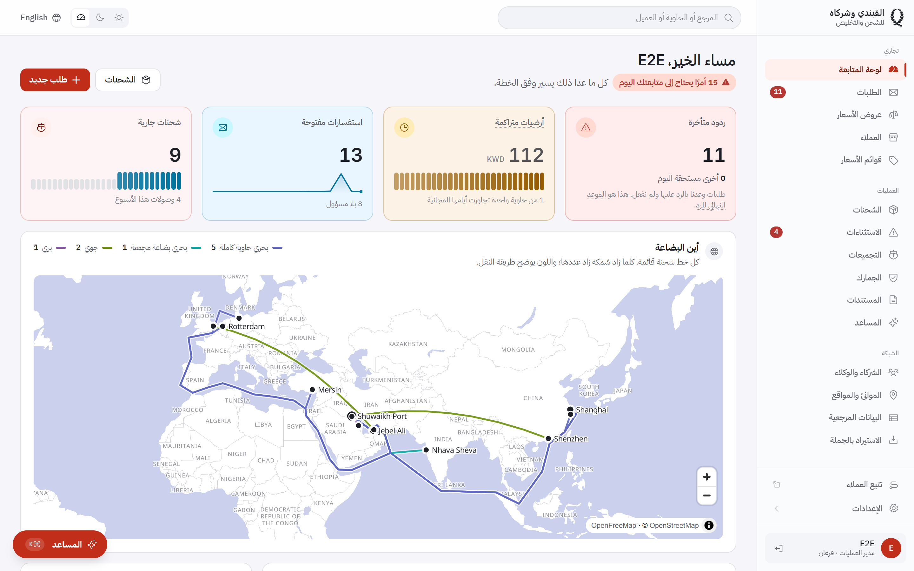

# The deck

**Fourteen slides, twenty minutes, and the words to say over each one.**

| | |
|---|---|
| **Audience** | Owner or managing director, plus the operations manager. Both, ideally in the room together. |
| **Room** | Their office. Their coffee. A laptop and a phone, not a projector, if there are fewer than four of them. |
| **Rule** | The demo is slides 5–9 and it is *live software*, not screenshots. If the software cannot be live, do not run this deck — run the recorded fallback and say why. |

> **Ordering principle:** the least explainable thing happens first. Nobody needs
> a slide to understand a container appearing on a phone. Everything that needs
> explaining comes after they already want it.

---

## Before you start

Two people. One drives, one watches faces. The one watching faces does not
speak during slides 5–9 except to answer a direct question.

Three things prepared in advance, without which this deck does not work:

1. **Their own data in the system.** Not a demo dataset. Their lane, their
   customers, their rate card. If you are running on generic sample data, cut
   slides 5–9 entirely and run a shorter conversation — a product tour on
   fictional data teaches them nothing about themselves.
2. **One enquiry they answered recently**, and the honest turnaround time.
3. **A phone with the tracking page already open**, unlocked, screen bright.

---

## Slide 1 — Nothing on screen

**On the slide:** their logo, nothing else. Or the laptop lid closed.

**What you say:**

> "Before I show you anything — when a customer rings and asks where their
> container is, walk me through what happens. Who picks up?"

Then stop talking. Let them describe it. Write down the number of people and
the number of systems they name. You will use both later.

**Why:** everything after this lands harder if they said the problem out loud
first. It also tells you which of the three moments to lean on.

---

## Slide 2 — What we found

**On the slide:** three lines, large type.

> Five mailboxes.
> A rate card in Excel.
> "An estimate within 24 hours."

**What you say:**

> "This is from your own website and your own company profile. I am not telling
> you anything you do not know. I am telling you we read it."

**Why:** it establishes you did homework on *them*, not on freight forwarding
in general. Replace the three lines per prospect — they must be specific or the
slide is worse than nothing.

---

## Slide 3 — What this costs, in the language of their business

**On the slide:** three numbers with no source claimed.

> The quote you sent second.
> The lane you priced from a rate that expired in March.
> The demurrage nobody noticed until the invoice arrived.

**What you say:**

> "I am not going to put a figure on these, because you know yours and I do not.
> But every one of them is a system problem, not a people problem. Your people
> are fine. They are working from spreadsheets and memory."

**Why:** never quote an industry benchmark to an owner about their own
business. They will spend the rest of the meeting arguing with the number
instead of listening.

---

## Slide 4 — What we built

**On the slide:** one line.

> **Cargolane.** Freight forwarding software built in the Gulf, for the Gulf.

**What you say:**

> "Built with a Kuwaiti forwarder, over [N] months, on their own operation.
> Arabic and English from the first line of code. Your brand on it, your
> database under it. I would rather show it to you than describe it."

Ten seconds. Move.

---

## Slide 5 — **Moment 1: the phone** · *live*

**Not a slide.** Hand them the phone with the public tracking page open.

**What you say:**

> "Type in a reference you recognise. Any one."

They type. Milestones, route, vessel, ETA, containers, released documents.
Let them read it. Do not narrate.

Then, when they look up:

> "Now press the Arabic switch."

Hand the phone across the table to whoever has not held it yet.

**What you say last:**

> "That is your shipment [reference]. Nobody was called. There is no login —
> a reference and a container number is all your customer needs."

**Watch for:** them typing a *second* reference you did not load. That is the
strongest buying signal in the whole meeting. If it happens, stop and let them.

---

## Slide 6 — The portal · *live*

**What you do:** sign in as one of the customers you loaded for them.

**What you say:**

> "Same data, more of it, because this one has an account. Their shipments,
> their documents, the ones you have chosen to release. You decide per document
> what the customer sees."

Thirty seconds. This slide exists to draw the line between *public* and
*account*, and for no other reason.

---

## Slide 7 — **Moment 2: the quotation** · *live*

**What you do:** enter the real enquiry they answered last month.

**What you say while typing:**

> "Origin, destination, mode, one 40-foot container. Nothing unusual."

Price it. The system reads their own rate card.

> "That is your rate card. Not ours, not a sample — the one you sent us."

Produce the quotation — their company name at the top, their trading
conditions at the bottom, in either language.

Then the punchline, delivered flat:

> "Twenty seconds. The real one took a day and a half — you told us that, I did
> not make it up."

**Watch for:** the operations manager checking the number against what they
actually quoted. Let them. If it is wrong, that is a data question and you fix
it in front of them — which sells better than being right.

---

## Slide 8 — **Moment 2b: the one for the owner** · *live*

**What you do:** switch to the internal comparison view. Buy, sell and margin
side by side on every option.

**What you say:**

> "This screen is not for your ops team. This is the one for you. You knew your
> margin before the quote went out, not at month-end when you reconstructed it."

**Why this is its own slide:** in most rooms this is the moment the owner
changes posture. Give it air. Do not click away from it for at least fifteen
seconds.

---

## Slide 9 — **Moment 3: the board** · *live*

**What you do, in this order:**

1. The enquiry queue — every enquiry, every branch, each with an owner and a
   clock. Point at one that has breached.
2. The operations board — live shipments, exceptions first.
3. A container on customs hold.
4. The demurrage counter, and the charge line it wrote.

**What you say, on the last one only:**

> "That charge line appeared on its own. The clock started when the free days
> ran out and it wrote the charge itself. Nobody had to remember, and nobody had
> to be told."

**Why last:** it is the least visual and the most operationally convincing. An
operations manager who has ever eaten a demurrage charge understands
immediately.

---

## Slide 10 — Why it is not a translated product

**On the slide:** the same screen twice, English and Arabic, side by side.

**What you say:**

> "2,700 strings, both languages, in sync. Right-to-left is in the layout, not
> bolted on — which is why the Arabic quotation reads correctly instead of
> reading like a mirror. Every product you have been shown was built in English
> and had Arabic added. This one had both from the first commit."

**If there is an Arabic speaker in the room:** hand them the phone and stop
talking. This slide either survives that or it does not, and you want to know.

---

## Slide 11 — Your brand, your database

**On the slide:** the same screen under two different brands.

**What you say:**

> "There is no colour, no logo and no company name written into this product
> anywhere. The operator is a setting. So this is your software, on your domain,
> and there is no supplier logo on anything your customer sees.
>
> And it is your database. One deployment per customer — your own
> database, in the region you choose. Not a shared table with a customer column.
> You can have a full export any day you ask, and if you ever leave, there is
> nothing to disentangle."

**Why this slide matters more than it looks:** for a prospect weighing a
port-operator's software, independence is the entire counter-position. Say
*"your landlord's software"* only if they raise CARGOES Runner first.

---

## Slide 12 — What holds when people are careless

**On the slide:** three lines.

> Separation enforced by the database itself, on every record.
> An audit trail nobody can edit — including us.
> Nothing is ever deleted.

**What you say:**

> "Branch separation is enforced by the database, not by application code that
> can forget. Ask for another branch's shipment and it comes back *not found* —
> the row is not visible to the query at all.
>
> The audit trail is written by the database itself, so a change that goes round
> the application is still recorded. Editing it is revoked from every account,
> including our support accounts. Your administrator cannot alter it and neither
> can we.
>
> And nothing is deleted — records are superseded or closed. Delete permission
> does not exist on the application account."

**Who this slide is for:** whoever they will send to review this before signing.
It is written to be repeated accurately by someone who is not technical.

---

## Slide 13 — What is not in it

**On the slide:** the honest list. Do not soften it.

| Not built | Status |
|---|---|
| Live container tracking feed from carriers | built for Maersk, Hapag-Lloyd and CMA CGM; runs on the customer's own carrier API credentials, so not live until they hold them |
| Direct customs filing, Kuwait | **not planned** — access is concessionaire-controlled |
| UAE MPCI filing | roadmap, dated |
| Saudi ZATCA e-invoicing | roadmap, dated — the invoice data is ready, the accredited transmission is not |
| Agent portal — agents responding to RFQs, posting milestones | in delivery — the route is scoped, the screens are not built |
| WhatsApp — notifications or intake | not in this release |
| Scheduled email reports | in delivery |
| Direct accounting-package integration | file export today, connectors later |

**What you say:**

> "I would rather you heard this now than in week three. Everything on the left
> is real and everything on the right is honest. If one of these is the reason
> you would buy, tell me now and I will tell you whether we can date it."

**Not on the slide, because it is built — have it ready if they ask:** house
bill of lading and air waybill, delivery order, packing list, customs pack and
consolidation manifest generated as bilingual PDFs from the job file; enquiries
emailed to a branch mailbox read into a proposal the coordinator accepts or
rejects; supplier bills read from a scan or a partner's email and matched
against what the job accrued; consolidation with cost apportionment; credit
standing and holds; email notifications; two-factor sign-in; a read API and
outbound webhooks; and an assistant that answers questions over their own data
and sees only what the person asking may see. Show any of these only if the
question is asked — the three moments are the demo.

**Why:** this slide closes more deals than slide 7. A vendor who volunteers
their gaps is the only kind a forwarder who has been burned will trust.

---

## Slide 14 — Fifteen days on your own data

**On the slide:** the pilot offer.

> **15 working days.** Your lane, your rate card, your customers, your job files.
> Fixed fee. Credited in full against the full build.
> Nothing is thrown away — the pilot *is* the foundation.

**What you say:**

> "Everything you just watched runs on your own data because we would build it
> that way for you too. Fifteen working days — and I mean from the day the rate
> card and the job files land, not from signature. That distinction is the whole
> risk in the project and I would rather name it now.
>
> The fee is credited in full if you go ahead. So the question in front of you is
> not whether to spend money. It is whether to spend three weeks finding out."

Then stop. Do not fill the silence.

---

## After the close

**Leave behind:** the one-pager, and nothing else. Not the deck.

**Send within 24 hours:** a written list of everything they asked for that was
not in the demo, split into *in the product*, *on the roadmap* and *not planned*
— with the same honesty as slide 13. Nothing sells a second meeting like a
prospect finding their own words in your follow-up.

**Do not agree to anything mid-demo.** Every "can it do X" that is not already
built gets written down, not promised. The scope document is the boundary, and
it is a boundary that protects them as much as you.

---

## What went wrong, if it did

| Symptom | What it means | What to do |
|---|---|---|
| They stay on features and price the whole meeting | The three moments did not land | Stop selling. Ask what they actually saw. |
| They ask who else can see it | They are thinking about *their* customers | You have won. Move to the pilot. |
| Only the ops manager engages, the owner is on their phone | Slide 8 came too late or was rushed | Next time, do margin before the board. |
| They ask about test coverage and deployment history | They have a technical reviewer | Good sign. Offer the security and coverage summary in writing. |
| "We already have CargoWise" | Not an objection, an opening | Ask what they pay now. |
