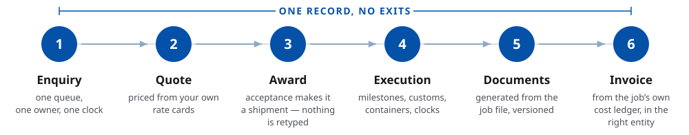
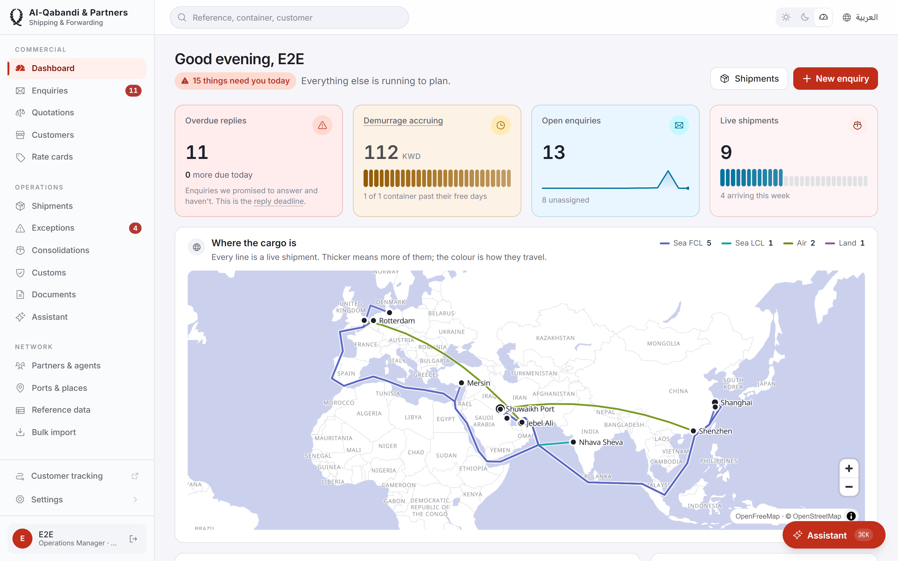

# Cargolane

**Freight forwarding software built in the Gulf, for the Gulf.**
Arabic and English from the first line of code. Your brand, your database, your data.

---

### The problem you already have

Your rates live in spreadsheets, so a quotation takes a day and a half.
Your enquiries live in four mailboxes, so nobody owns them and nobody is timed.
Your customers find out where their container is by ringing someone who has to go and find out.
And your margin on a job is a thing you reconstruct at month-end, not a number you knew when you quoted.

None of that is a technology problem. It is a *system of record* problem, and it costs you the jobs you priced too slowly and the ones you priced too cheaply.

---

### What Cargolane does about it

| | |
|---|---|
| **Quote in seconds, not days** | Load your carrier contracts once. An enquiry prices itself off your own buy and sell cards — sea FCL, sea LCL, air, land and courier — with chargeable weight, accessorials and the margin shown before you send it. |
| **One queue, with a clock on it** | Every enquiry across every branch, with an owner and a response deadline. What breached, what is due today, who has not replied. |
| **An operations board that surfaces the problem** | Live shipments ordered by what is wrong, oldest first — the one nobody has looked at is the one the process missed. Milestones, containers, vessel and voyage, customs status, ETA. |
| **Free time that counts itself** | Demurrage, detention and storage clocks run against the carrier's free days and write their own charge line. Nobody has to remember. |
| **Your customers stop calling** | A public tracking page — reference plus a container or bill number, no login — and a full customer portal with released documents. Both in Arabic and English. |
| **Documents from the job file, not re-typed** | House bill of lading or air waybill, delivery order, packing list, customs pack with a duty estimate, consolidation manifest — bilingual PDFs generated from the job data, numbered from your branch's own series, previewed before issue and versioned after. |
| **Enquiries read from the inbox** | An enquiry emailed to a branch mailbox is read into a proposal — parties, lane, cargo — that the coordinator accepts or rejects. Nothing becomes an enquiry without a person saying so. |
| **Supplier bills read, not re-keyed** | An uploaded scan or a bill emailed by a known partner is read into lines and matched against what the job accrued, with the variance shown before anything is approved. Agent accounts are netted per period, one balance rather than two; supplier payments are recorded against the bills they settle. |
| **Money you are owed, on one screen** | Invoices in three jurisdictions and three currencies, receipts, ageing buckets, credit standing against the limit, and who to ring about the oldest debt. Every charge line stores its own FX rate and the moment it was taken. |
| **An audit trail nobody can edit** | Written by the database, not the application. Editing or deleting an entry is impossible for every role — including ours. |

---

### Why it is different from what you have been shown

**It is bilingual, not translated.** 2,700 interface strings in Arabic and English, in sync, with right-to-left layout built in from the first commit rather than retrofitted. Your quotation and your tracking page read correctly in Arabic because they were designed to, not because a plugin flipped them.

**It is your brand everywhere.** Logo, colours, domain — on every screen and every page your customer sees; every document issued under your own entity's name, in both languages. There is no supplier logo anywhere in the product, because there is no company name or colour written into a single component.

**It is your database.** One deployment per customer. Your data sits in its own dedicated database, in the region you choose, and you can have a full export of it any day you ask. There is no shared tenant, no pooled table, and nothing to disentangle if you leave.

**Separation is enforced below the application.** Branch scoping, immutability and audit are enforced by the database itself, on every record — not by application code that can forget. A request for another branch's shipment returns *not found*, because the row is not visible to the query at all.

---

### What it costs you to try

**A 15-working-day pilot on your own data.** Your busiest lane, your rate card, your customers, twenty of your completed job files. At the end you type one of your own shipment references into a phone and watch it answer.

The fee is fixed, small enough to decide in one meeting, and credited in full against the full build if you proceed. Nothing built in the pilot is thrown away — it is the foundation of the live system.

---

### What is not in it yet, said plainly

Carrier tracking is built for Maersk, Hapag-Lloyd and CMA CGM but runs on your own carrier API credentials, so it is not live until you hold them. Direct customs filing in Kuwait is not planned; declarations, duty and the clearance clock are tracked, the broker files. Accounting-package connectors are not in this release — there is a file export your accountant can import. UAE MPCI filing and Saudi ZATCA e-invoicing are on the roadmap with dates: the invoice data is ready, the accredited transmission is not. The agent portal and scheduled email reports are in delivery. WhatsApp is not in this release. We will show you the list in the first meeting rather than the third.

---

**techpotions** · Built with AL-QABANDI & PARTNERS Co. (Shipping & Forwarding), Kuwait
hello@cargolane.com · cargolane.com
